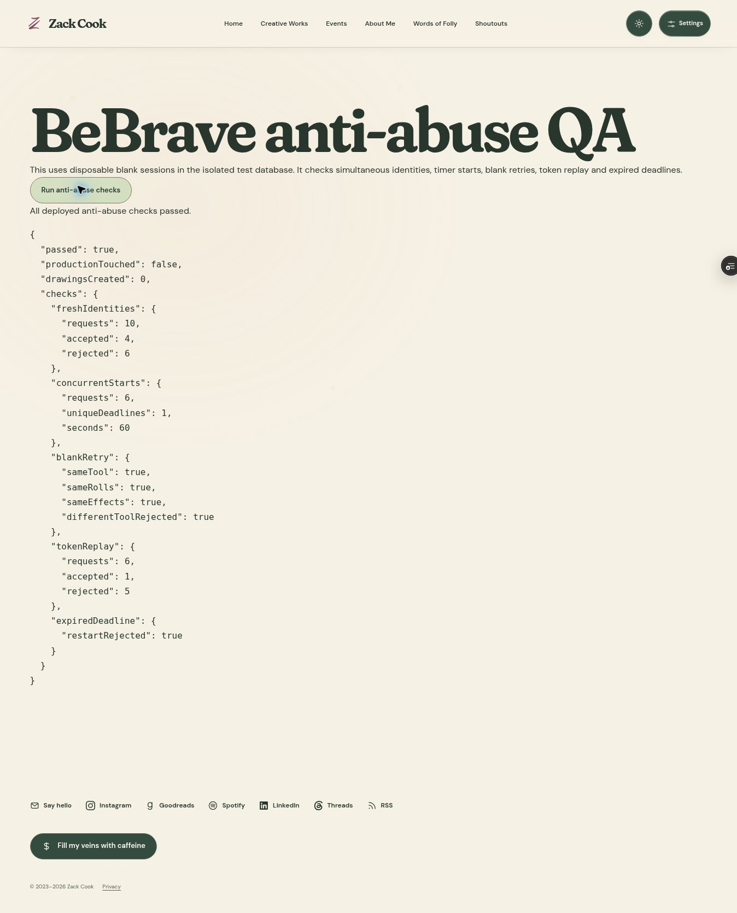

# BeBrave anti-abuse preview — 2026-10-14

Status: verified on the isolated TEST database and a preview of the current production source. No production deployment, environment change, migration, test session, drawing, or code redemption was performed for this work.

Source: `feature/bebrave-anti-abuse-2026-10-14`, application commit `ffce3077c0425c6a37b3b7978529b4eb48269181`. Baseline production/main is `587c47cbabb3e19d36490f3235821176c6b8cbf5`, retaining the current caret CSS correction. Vercel preview `dpl_4JyGCHPhaMivmhKtuJXnJQEQgtg5` is READY. The existing production deployment remains `dpl_GaF9aCfeE1JMihyzRkWp6whAWzEf`.

- Game: https://zack-cook-ecfdvbf2e-dove-mack0o-3684.vercel.app/bebrave
- Passing QA: https://zack-cook-ecfdvbf2e-dove-mack0o-3684.vercel.app/test-bebrave-security
- TEST project: `qkkgcoejkqvthbjcldcw`.
- Production project: `belqlsqnbexwkpmnptyy` (read-only preservation checks).

## Behavior and limits

Ownership remains tied to the random visitor cookie. A network never grants access to another player's session. The server derives a secret-keyed connection hash from the hosting platform's client IP header, normalizing IPv4/mapped IPv4 and IPv6 /64 groups. Missing trustworthy production network information fails closed. There is no MAC lookup, canvas/audio/device fingerprint, client-supplied network identifier, or silent identity merging.

Postgres transaction/advisory locks atomically enforce:

| Signal | Allowance |
| --- | --- |
| New anonymous identities on one connection | 4 per 10 minutes; 6 per rolling 24 hours |
| New drawing timers on one connection | 6 per 15 minutes; 12 per rolling 24 hours |
| Independent attempts on one connection | 4 until the tree grows 5 feet from the cycle's first drawing start |
| Existing request limits | 8 session requests per visitor and 24 per network per hour remain |

The fixed growth anchor prevents four cookie-reset carvings from opening a sliding sequence of replacement slots through their own growth. A blank retry retains its attempt root and does not spend a new growth slot; it does count as a new timer start. Existing per-visitor completed-carving growth eligibility is retained.

Blank attempts clone into a new ready session with the original tool, all three ordinary rolls, rarity, color, seed, effect, symbol, cache/code references, and unconsumed Legendary reward. Tree growth does not clear that choice. The original empty session is retained unchanged. Running sessions return their original deadline; expired sessions cannot gain extra time. Only the requesting player's overdue drawing is finalized during preparation, avoiding a sweep of unrelated users' sessions.

Turnstile keeps server-side hostname/action/provider validation in production. A token digest is atomically claimed before verification, so concurrent replay cannot reach repeated successful verification. The preview retains the established isolated TEST-only human-check bypass; its exact-project, environment, and nonproduction guards are tested. QA page/API return not-found before storage access outside that configuration.

New security records are private, RLS-enabled, and unavailable to browser roles. Connection records expire after seven days of their relevant activity, and the hourly cleanup deletes expired private records only. Token digests expire after ten minutes. No drawing/archive/code is deleted by cleanup. The privacy page explains security-only use, retention, and shared-connection waits. Provider request-log retention is separate.

## Verification

- `npm test`: 168 passed (148 standard, 20 module-mock tests), zero failures.
- `npm run typecheck`: passed.
- `npm run build`: asset/theme checks and optimized 51-route build passed.
- `git diff --check`: passed.
- `tests/bebrave-anti-abuse.integration.sql`: passed on TEST only, in a rolled-back transaction. Covers fresh-cookie identities, fixed network growth cycles including self-growth, daily caps after short windows expire, personal growth, blank retries after five-foot growth, unchanged original empty rows, ordinary and Legendary effects/reward retention, ownership, browser-role restrictions, timer restart/expiry, and late strokes. No real distribution code was used.
- Actual concurrent TEST requests and deployed QA: 10 fresh identities yielded 4 distinct owners and 6 denials; 6 starts yielded one exact 60-second deadline; 6 challenge claims yielded one acceptance and 5 replay denials; blank retry preserved results and rejected another tool; expired timer restart was rejected.
- Actual preview browser → session API → choose API → start API → TEST database → finish API → retry: arrowhead/uncommon/yellow, seed `1201875300`, rolls `6758/6754/6884` retained exactly. Retry went directly through the retained-tool reveal/warning rather than offering another tool choice. Original attempt `65692ea3-7d99-452e-a65c-5ff7b469a77e` ended empty. Its zero-point unstarted retry `f27638fe-1781-4afe-9cf9-048b8994ac7c` was reversibly cancelled. No mark, archive, growth, or reward was generated.
- Cloudflare success, failure, expired/invalid token, hostname/action mismatch, missing token, and replay sequencing are covered by provider-response mocks and actual database nonce claims. A real production CAPTCHA token was not acquired or replayed; production abuse testing is explicitly excluded.

Deployed QA returns `passed: true`, `productionTouched: false`, and `drawingsCreated: 0`. Disposable random zero-point fixtures are left empty/cancelled; their private audit records expire normally.

## Preservation evidence

Sorted row-JSON MD5 checks before and after all testing match exactly. These are change-detection checks, not cryptographic backups.

| Environment/data | Rows | Unchanged digest |
| --- | ---: | --- |
| Production completed archives | 1 | `cfe4111ad84d3193649f95ccd2073aba` |
| Production stroke chunks | 0 | `d41d8cd98f00b204e9800998ecf8427e` |
| Production completed sessions | 1 | `3384582911e06b135ca6edc4a44627ae` |
| TEST completed archives | 61 | `be9ddb3ac2d45e0ad31627a25b44e25e` |
| TEST stroke chunks | 20 | `fe78e4a7c2716cf94cb66deb66cbade3` |
| TEST completed sessions, excluding two newly added null lineage columns | 61 | `ccfa41ff089be8350834d56371262ec8` |

## Release and practical boundaries

The additive release migration is **only** `supabase/migrations/20261014102930_bebrave_participation_guards.sql`. It is installed and registered in TEST migration history; no existing drawing data was backfilled or copied. The connector's migration action failed before applying anything, so the schema was iterated transactionally on TEST and the canonical migration recorded after verification. Do not broadly push unrelated pending TEST migrations or copy TEST data into production.

A future production release needs that one migration and this tested application branch. Keep production's genuine Turnstile settings and production database configuration, with TEST flags absent. Do not run the integration suite or preview QA against production. Preserve the original production drawing records; compare their preexisting-column checksums again around any authorized release. Existing sessions and rendered archive geometry are supported.

This is bounded anonymous participation, not proof of one human/device. The four-person household allowance can also be consumed by one person clearing cookies. Different networks/VPNs, mobile connection changes, and expiration of the limited-retention signal remain possible escape routes. A strict one-person guarantee cannot be combined with no accounts, no invasive identity collection, and reliable distinction between family members behind the same IP. Stronger guarantees require a separately agreed participation/identity policy.

Ordinary websites cannot read or ping a device MAC address. Chrome's network/MAC API is restricted to enterprise-policy-installed ChromeOS extensions: https://developer.chrome.com/docs/extensions/reference/api/enterprise/networkingAttributes. Network hashes remain pseudonymous security data, not a claim of complete anonymization. Purpose limitation, short retention, private access, and disclosure minimize collection; they are not a blanket legal certification. Applicable privacy/consent requirements depend on jurisdiction and actual use. ICO security/strictly-necessary guidance: https://ico.org.uk/for-organisations/direct-marketing-and-privacy-and-electronic-communications/guidance-on-the-use-of-storage-and-access-technologies/what-are-the-exceptions/.

Housekeeping: publish these evidence notes on the feature branch, then stop the existing cautious-trout Codespace and close its editor immediately. Retain the clean original spring-clean checkout and the separate anti-abuse worktree. No new Codespace, force push, main merge, protection weakening, secret extraction, or production cutover is part of this preview acceptance.
