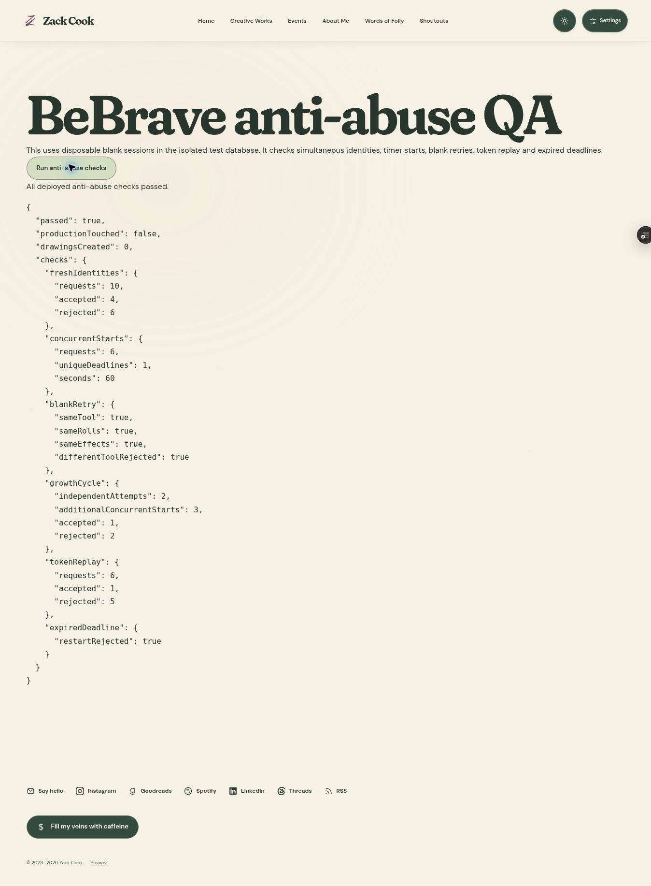
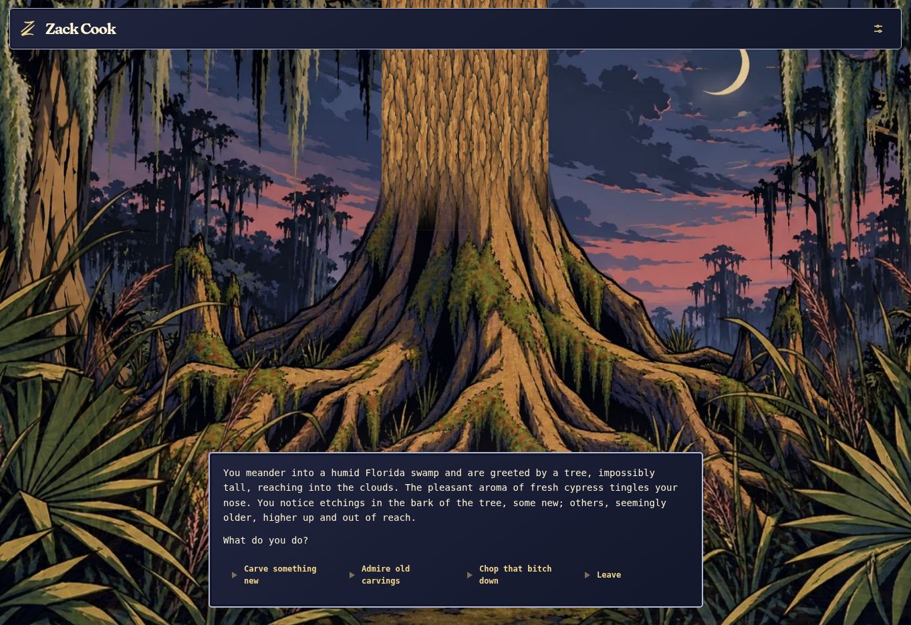

# BeBrave anti-abuse production release — 2026-10-14

Zack authorized production release with **two independent attempts per shared connection per fixed five-foot growth cycle**. This supersedes the earlier four-attempt preview policy and preview-only publishing scope.

Application commit `865b9ffc0ed16691aa75bb58d0a10f83156bfcf7` was normally fast-forwarded from production/main `587c47cbabb3e19d36490f3235821176c6b8cbf5`. Vercel production `dpl_75hG8KysMuZNF2d6UhF5LFyzjmwW` is READY, built in 38 seconds, and was verified Current with `zackdcook.com` assigned. Live URL: https://zackdcook.com/bebrave. Documentation-only descendants do not change this application.

The release retains atomic short/day limits, personal growth eligibility, cookie-independent keyed network signals, immutable blank-attempt tool/roll/effect preservation, original running deadlines, expired timer rejection, atomic challenge claims, private service-only records, limited retention, and privacy disclosure. Only the independent-attempt growth allowance changed from four to two; fresh-identity request and drawing-start time-window limits retain their previous values. Shared-network players retain separate ownership.

## Verified before release

- TEST project `qkkgcoejkqvthbjcldcw` only: adjusted rollback SQL suite passed. Two separate owners completed valid rollback carvings; a third remained growth-blocked after short-window expiry. Three feet of unrelated growth opened the next fixed cycle, which again stopped after two independent attempts. No fixture drawing or growth persisted.
- `npm test`: all 168 passed (148 standard and 20 mocks), zero failures. Typecheck, asset/theme validation, whitespace, and optimized 51-route build passed.
- READY TEST preview `dpl_4PJYptnERbHCJYJRV6dmcrcfDDvB`, same application commit, https://zack-cook-hv6dpdoav-dove-mack0o-3684.vercel.app/test-bebrave-security: deployed acceptance returned `passed: true`, `productionTouched: false`, `drawingsCreated: 0`.
- Ten concurrent fresh-identity preparations yielded four accepted/six short-window denials. With one attempt already started, three simultaneous independent starts yielded exactly one further start and two growth denials: **two independent attempts total**. Blank retries still retained the original tool/results and could retry within the same root. Concurrent same-session starts retained a single 60-second deadline; challenge replay and expired timer restart were denied.
- Security advisors on TEST and production report INFO-only default-deny RLS tables without browser policies, intentionally service-only; no warning/error finding. Reference: https://supabase.com/docs/guides/database/database-linter?lint=0008_rls_enabled_no_policy.

## Production migration and configuration

Only the reviewed `20261014102930_bebrave_participation_guards.sql` and `20261014120857_bebrave_two_attempt_growth_cycle.sql` were applied, together through one successful atomic Supabase migration action on production `belqlsqnbexwkpmnptyy`. Their canonical versions were registered in migration history for future tracking. No unrelated TEST migrations or data were copied.

The tightening migration replaces the locked participation gate with `cardinality(w.attempt_roots)>=2`. Prior stored TEST windows/roots remain intact so old blank attempts can retry; the older storage constraint supports their historical maximum of four. Production starts enforce two through service-only guarded functions. No original session, archive, chunk, reward, code, or tree data was updated by either migration. Two nullable lineage columns were added to sessions without backfilling.

Read-only production metadata confirms the two-attempt gate, one active hourly security cleanup job, and zero nonzero TEST reset markers. Vercel production points to `https://belqlsqnbexwkpmnptyy.supabase.co`; genuine production Turnstile and HMAC configurations remain present. TEST flags are preview-only. No production environment setting, secret, deployment protection, or Cloudflare bypass was changed.

## Live inspection and preservation

The production game loads normally and has no Reset control. Its read-only state endpoint returned HTTP 200, `enabled: true`, height 8928, revision 2, completed count/sequence 1, no session, and no growth wait for a new browser. A production CAPTCHA was not completed and no production session/start/stroke/redemption/abuse test was submitted. All abuse simulations stayed on TEST. The Vercel runtime-log panel, filtered to this deployment and the last 30 minutes, showed no runtime logs and zero error/fatal entries; this is a limited observation, not a complete invocation trace. Final housekeeping stops the existing Codespace and closes its editor after publishing these evidence notes.

Pre-release, post-migration, and post-deployment original drawing checksums match exactly:

| Data | Rows | Unchanged digest |
| --- | ---: | --- |
| Production completed archives | 1 | `cfe4111ad84d3193649f95ccd2073aba` |
| Production stroke chunks | 0 | `d41d8cd98f00b204e9800998ecf8427e` |
| Production completed sessions, preexisting fields | 1 | `3384582911e06b135ca6edc4a44627ae` |
| TEST completed archives | 61 | `be9ddb3ac2d45e0ad31627a25b44e25e` |
| TEST stroke chunks | 20 | `fe78e4a7c2716cf94cb66deb66cbade3` |
| TEST completed sessions, preexisting fields | 61 | `ccfa41ff089be8350834d56371262ec8` |

Session checks exclude the two newly added null lineage columns when comparing against pre-migration rows. Sorted row-JSON MD5 is used as a change detector, not a backup or cryptographic integrity guarantee.

Anonymous limits still cannot prove one human/device: one person may consume both shared-connection slots or change networks. The signal is security-only pseudonymous data with limited retention, not MAC access or device fingerprinting. These boundaries remain disclosed; this release does not claim universal legal certification.

Rollback reference: prior production application `587c47c`, deployment `dpl_GaF9aCfeE1JMihyzRkWp6whAWzEf`. Do not delete drawings or broadly roll back database data. The additive schema supports existing sessions; any rollback should preserve the reviewed database safeguards and production credentials.
