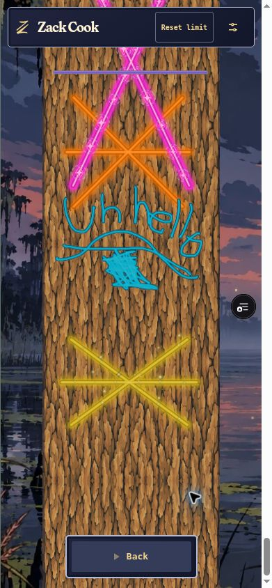
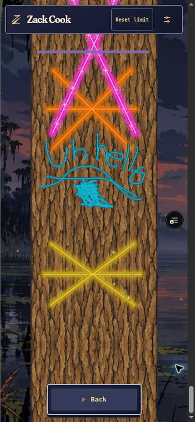
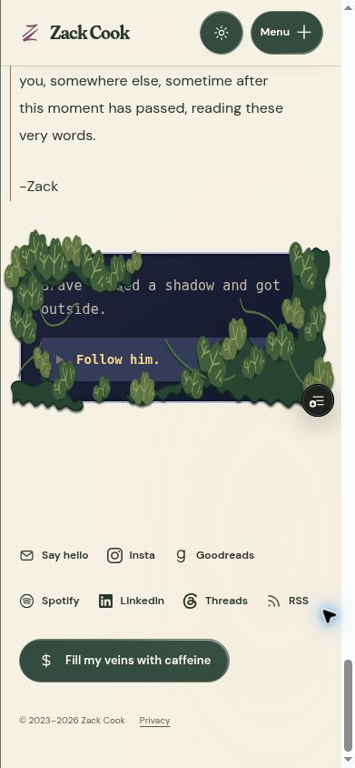

# Be Brave enchantments and site refinements

Completed test revision, 2026-10-13. This work continues application commit `4671459163fdbeb45038b3bf5e279ce0b64805fe` without changing the production site.

## Review version

- Application: `79d960380ef5689f881828068cf5ed010b25b7a2`.
- Branch: `experiment/be-brave-enchantments-2026-10-12` in `zackdcook/zackdcook.github.io`.
- READY Preview: `dpl_4WRbaStv9CowGa6Lo9EFGyRjWJP8`.
- [Open Be Brave test](https://zack-cook-git-experiment-be-brave-encha-6d0cb7-dove-mack0o-3684.vercel.app/bebrave). Use its wordmark to review the public pages in the same test build.
- Immutable deployment: `https://zack-cook-aiz45ywv7-dove-mack0o-3684.vercel.app`.
- Main remains `75de96bb3ef7a4edf138d07ee313519bb3bb212e`; production remains READY `dpl_4Uzwt4ELBoYd8ckmEAR1jkQP7PqQ`. Both were rechecked after the final application deployment.

## Result

Superior has a crisp colored core, saturated luminous band, broad soft halo, and slow breathing brightness. It has no particle elements. Epic shares that foundation and adds seeded floating motes, sharp twinkles, satellites, occasional curling trails, and brighter anchored glints. The extra dark edge on its brightest sparks keeps gold legible against warm bark. Common and Uncommon use the same engraved edge and inlay vocabulary without glow. Legendary retains its existing separate effects.

All subpaths belonging to one carving share each ink layer, so a visitor's own crossing lines retain their core and pigment instead of repeatedly blending. Live drawing, settled strokes, published carvings, and archived geometry use the same renderer. Existing seed and anchor data reconstruct the animation after refresh. There is no storage migration or new per-frame JavaScript particle loop.

Visible Superior and Epic effects continue through the whole tree history; offscreen or hidden-tab effects pause. Crowded views reduce Epic anchor density and omit satellites instead of freezing older Epics entirely. Reduced effects and reduced motion remove the outer halo and moving particles and leave static readable ink and glints.

Admire uses `min(68%, 640px)` world width. Its atmospheric progress spans the complete tree: scenery fades away, parallax continues with altitude, and the sky passes through dark blue and purple into black at the oldest carving. Reduced effects keeps the sky progression while suppressing parallax transforms.

Clicking a tool selects it immediately. The `>` caret blinks on the highlighted tool. The subsequent rarity narration still has its own Continue action before the deliberate drawing start.

The About invitation has connected moss banks, runners, and tufts across the frame, face, and text. Its accessible link name remains complete. `-Zack` is the final biography paragraph before it. Footer links are Say hello, Insta, Goodreads, Spotify, LinkedIn, Threads, RSS, with color-responsive native icons. Spotify uses the supplied account URL without referral parameters. Privacy sits beside the copyright in matching 10px DM Sans with an underline and a larger hit area.

A root input-mode component now distinguishes pointer/touch input from keyboard navigation. It suppresses native pointer focus outlines, hidden preference-input sibling rings, and the portrait's inner-face outline while preserving keyboard rings. The Home cat scene resets on client navigation back to Home and on page restoration.

Privacy is reduced to the disclosures needed to describe the implemented email signup, anonymous contributions, essential browser state/security, analytics choices, processing providers, retention, and contact requests. It has no named game reference or return-to-game link. This is an implementation-aligned notice, not a jurisdiction-specific legal opinion.

## Verification

| Check | Result |
| --- | --- |
| Standard TypeScript tests | 114 passed |
| Module-mock tests | 7 passed |
| Type checks, asset generation, theme generation | Passed |
| Optimized Next build | Passed, 48 routes |
| Whitespace/diff check | Passed |
| Pointer preference focus / keyboard Tab focus | Pointer ring absent; keyboard checkbox ring retained |
| Portrait inner-face focus | Root suppression added after selector audit |
| Home navigation reset | Discover cats, navigate About, return through wordmark: original image and three bird controls restored |
| 390 × 844 About | Signature, whole-button moss, requested footer order, matching copyright/Privacy font, no horizontal overflow |
| Canonical navigation | Header links resolve directly to `/aboutme` and `/creativeworks` |
| Privacy | Absolute self-canonical, no Be Brave name or game return link |
| Admire normal phone zoom | World width 255px in a 375px inner layout; Superior glow and Epic animation visible |
| Entire Admire ascent | At actual oldest scroll position: sky `#020308`, horizon and midground opacity 0 |
| Rarity rendering | Common/Uncommon: no halos/particles; Superior: halo/no particles; Epic: halo/particles; Legendary preserved |
| Live publication and refresh | Superior and Epic completed, archived, shown in Admire, refreshed with color/geometry intact |
| Final Epic deployment | 18 original emission anchors unchanged, 18 moving particles and 18 glints; animation state running and opacity/matrices changed between observations |
| Reduced effects | Moving particles and halo hidden; glint animation none and filter none; restored afterward |
| Light/dark themes | Latest living Superior/Epic reviewed in both; local felling and fallen-tree rendering also smoke-tested in both |
| Local felling | Chop/confirmation/final strike/immediate fallen Admire passed; native horizontal scrollbar moved 0 → 1706px |
| Final review state | Living timeline, default preferences, eligible Carve button, no active drawing session |

Browser checks used Chrome with native mouse input and a same-origin phone viewport. Physical iPhone/Safari, finger/stylus input, OS motion preference, continuous fall timing, and unthrottled GPU/FPS are not certified. Dense rendering remains subject to device performance; no speculative archive/storage rewrite was made.

## Test data evidence

Only the isolated Supabase test project `qkkgcoejkqvthbjcldcw` received QA writes. The initial 41 archives retain the same ordered checksum digest `a119e36947da57cd1636a5fc9f7139e0`. Final tree height is 35,712 units (124ft), revision 111, completed count 43: exactly two nonempty QA publications above the baseline.

| Session | Rarity and method | Result |
| --- | --- | --- |
| `58ccf697-b67f-4bf8-803c-38555cf974dc` | Natural Superior nail roll 8290; `#FF7A00`; seed 2139439560 | Sequence 42; 3 strokes, 27 original points; timed publication and refresh passed |
| `d2072ddd-1d3a-4480-b56f-b249f71daa21` | Controlled Epic nail roll 9950 on the owned unchosen test session | Empty: inspection used up the timer before drawing; 0 points, no archive, no growth |
| `5dd66546-2d2c-4350-b0be-71a271b08e39` | Controlled Epic nail roll 9950 on the owned unchosen test session; `#D8B414`; seed 1572107809 | Sequence 43; 3 strokes, 27 original points; live effects, timed publication, refresh, 18 anchor identities, continuing animation passed |

Controlled rarity updates were restricted by owned session, matching visitor identity, and `tool_select` status. No existing published carving, code, redemption, schema, or production data was modified. Current test code count is 0; this run did not issue or redeem distribution codes and did not read the earlier private distribution CSV.

Superior archive checksums:

- Source SHA-256: `ad65a2882b93bb8f493e3572e47546ffeb96a016a948a448a73a41d8fa693738`.
- Payload SHA-256: `571684c7cbae001dac394a227a834c1b5af593965ee7c7c035e9e299529cd9e6`.

Epic archive checksums:

- Source SHA-256: `925833ba44a9f4525df2fa12a75e76eafa8b4a9363b3d72709d9a7e41e2f3362`.
- Payload SHA-256: `753b6e85c086ad45e2e01021ff2289b98dcbf2965e80afa07ad2c9a6dbe62ec3`.

The existing render projection compacts collinear points; the original archive retains all 27. Refreshed path strings matched the published projections exactly:

```text
Superior: M126.4 33966.7 L568.7 34409.0 M568.7 33966.7 L126.4 34409.0 M97.5 34187.9 L597.5 34187.9
Epic: M116.7 34947.5 L587.9 35293.6 M587.9 34947.5 L116.7 35293.6 M78.3 35120.6 L626.3 35120.6
```

## Search discovery

The prior rewrite aliases returned duplicate 200 pages for `/about-me` and `/creative-works`, while the navigation and sitemap used other versions. They now permanently redirect directly to `/aboutme` and `/creativeworks`. Legacy aliases also go to the same destinations, avoiding redirect chains. Public page metadata uses absolute canonicals, navigation uses those same paths, and the sitemap includes canonical content, Privacy, and RSS.

Preview remains deliberately noindex/disallowed, and game pages remain intentionally excluded. The attached Search Console categories do not identify the affected URLs: pages that redirect and alternate pages with proper canonical tags can be expected exclusions. The private report was signed out and could not be verified. Do not claim that every reported exclusion is an error or that Google's report has cleared. The production release and Google's recrawl are required before checking the affected examples and requesting validation if appropriate.

Reference: [Google canonical guidance](https://developers.google.com/search/docs/crawling-indexing/consolidate-duplicate-urls) and [Page indexing report explanations](https://support.google.com/webmasters/answer/7440203).

## Prepared production switch — after test acceptance

1. Fetch main again and preserve any work added since `75de96b`. Review and integrate this branch normally; do not overwrite concurrent history.
2. Build a new production-configured artifact from reviewed main or the already allowed release branch. **Do not promote this Preview artifact**: it was built with test Supabase and test guards.
3. Keep production storage at `https://belqlsqnbexwkpmnptyy.supabase.co`, with `BEBRAVE_TEST_MODE` and `BEBRAVE_TEST_PROJECT_REF` absent. Existing deployment guards enforce production origin and allowed source branches. Production read-only inspection found the required 13 RPC signatures, including archive and legendary functions; no migration was necessary for this visual change.
4. Retain the genuine production Turnstile public key and existing secret. Verify the original token path for carving, cache redemption, and book signup rather than the isolated test bypass. Current server verification checks success, hostname, and action. The production environment already has genuine Turnstile configuration; no secret rotation or credential extraction is needed.
5. Confirm reset-carve controls disappear and test pages remain unavailable under production guards. Verify the real challenge's UI and server rejection behavior without creating fake production subscriptions, carvings, or redemptions.
6. Check staged production HTML canonicals, redirect destinations, sitemap, robots, public navigation, light/dark effects, and absence of test controls. Promote only that verified production-configured artifact, retain the existing deployment as rollback, then inspect the actual affected Search Console URL examples after recrawl.

The production cutover has not been performed. No production environment, database, domain alias, schema, protection, or paid resource was changed during this task.

## Visual evidence

These screenshots are from the final application and are stored with this Git-backed QA record. A still frame does not demonstrate motion; the changing computed transforms and native live/publication checks above provide that evidence.







The separately captured `enchantments-epic-live-1791851175561.jpg` was taken after completion despite its filename and is deliberately excluded as live-drawing proof.
