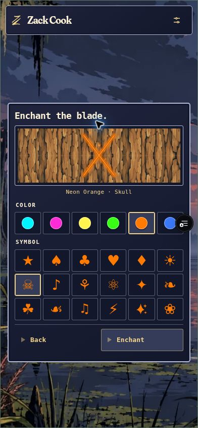

# Be Brave final cleanup — v7 test revision

Continues exact deployed v6 source `92db7be9ad303631bd97f6fb11b681e670935ab7` on the existing experimental test branch. Local isolated worktree: `work/be-brave-final-cleanup-2026-10-13`. No main merge or production release is authorized.

The code entry retains its native alphanumeric input and Enter/Back actions; the numeric button pad is removed. Knife reveal keeps its orange aura and 23 stars, now with independently seeded positions, sizes, rotations, lifetimes and phases. Stars avoid the label area.

The blade workshop offers exactly six pigments: cyan, magenta, yellow, green, orange and electric blue. The six lighter swatches and peach are removed. New Uncommon rolls share this palette with Superior but retain the unlit engraving treatment. Existing stored colors are preserved. The smaller X preview, six-column symbol grid and compact spacing are intended to fit a phone without scrolling; deployed visual acceptance is recorded below.

Personal Crimson now emits both monochrome U+1FAB6 feathers and U+1F5E1 daggers from the same reusable code. The saved dagger selection remains compatible; the mixed particle set is rendered from the effect ID without changing archives or code verifiers. The workshop displays the pair together.

Felled entry changes Admire to Mourn the fallen and adds Leave (Home) after Regret your decisions. The obsolete radial trunk-cap decoration is removed. Fallen-tree pinch and Ctrl-wheel zoom use the same 0.5–1.5 limits, maintaining the carving under the fingers while horizontal panning and vertical overflow remain available. Scenery remains stationary.

During drawing, selection/context-menu/drag suppression now covers the document, clears any existing editable focus and selection, and cancels native touch selection on the bark. Listeners are fully removed when drawing ends. Actual iPhone Safari double-tap and long-press behavior still needs device confirmation.

## Verification

143 standard tests and 11 API/module-mock tests pass (154 total). TypeScript, generated artwork/themes, optimized Next.js build, and whitespace checks pass. The build initially rejected the cross-worktree node_modules symlink; copying the same installed dependencies into this worktree resolved it without package changes.

TEST-only migration `20261013201029_bebrave_final_cleanup.sql` updates the owned-session enchantment color whitelist and personal catalog description. Selection/reselection, removed-pigment rejection, foreign ownership, personal enforcement, drawing/completed immutability and restricted grants pass in a rolled-back service-role transaction. Security advisors retain only the existing service-only RLS INFO notices; no new security warning. See https://supabase.com/docs/guides/database/database-linter?lint=0008_rls_enabled_no_policy .

Test project `qkkgcoejkqvthbjcldcw` still has 49 archives, full-row digest `321262d8ba34fdfb8b38e1b8b4c35751`, and 62 code rows including earlier QA fixtures, full-row digest `1ed7f6744660e62a714ccd96a37f32ce`. Both digests match before/after. No plaintext distribution code was accessed or redeemed.

## Published test preview

Application commit `7fd7677118523946f67260e12aadbd9f1f83fe06` and its documentation descendants were normally pushed to `experiment/be-brave-enchantments-2026-10-12`. READY Preview `dpl_EkoJxUTA5552LsDM88gxZq8x9wep` builds exact Git commit `2e3c7791c3243c8d6adc09a803d6468afc27869b`.

- Stable game: https://zack-cook-git-experiment-be-brave-encha-6d0cb7-dove-mack0o-3684.vercel.app/bebrave
- Immutable build: https://zack-cook-32brw8bv1-dove-mack0o-3684.vercel.app/bebrave

The stable test alias was explicitly assigned to this READY deployment and verified. No additional application build is needed for the documentation-only descendant containing this report and its screenshot.

The prior automatic approval rejection of workspace trust was resolved by Zack's explicit “Yes you have authorization.” Trust was enabled for the existing repository only. Publishing used the established isolated native Git mirror, exact bundle hash/base checks and ordinary fast-forward pushes. The original Codespace checkout remains clean on `spring-clean-2026-10`. Vercel publication succeeded using the existing authenticated user scope; the earlier explicit team scope was the cause of the denied request. No credential extraction, broader permission grant or deployment-protection change was made.

## Rendered browser acceptance

The deployed workshop was operated through the guarded phone viewport fixture. Color and symbol selections, color reselection retaining the symbol, and the Enchant action passed. Exactly six colors and all 18 ordinary symbols remain.

| Chromium CSS viewport | Document overflow | Picker-body overflow | Panel bounds | All colors, symbols and actions visible |
| --- | --- | --- | --- | --- |
| 390 × 844 | 0 px | 0 px | 201.72–714.27 px | Yes |
| 320 × 568 | 0 px | 0 px | 91.05–548.95 px | Yes |

The personal workshop offers only Crimson and the fixed Feather and dagger pair; its caption reads “Crimson · Feather & dagger” and it also has zero document/body overflow at 320 × 568. The mixed-symbol painter is covered by the automated tests. This review did not redeem a distribution code.

The real rendered Legendary knife fixture has 23 stars with 23 distinct sizes and timing phases. Their independently varied positions span x6.26–93.35% and y7.42–82.32%, avoiding the label. The orange aura remains present.

The fallen synthetic tree has no cap node or circle. Native scrollbar dragging advanced 1,110 px and kept ten drawing nodes in its bounded window. The real game was felled locally, displayed Mourn the fallen / Look at the stump / Regret your decisions / Leave in that order, and opened its frozen archived tree without the circular cap. Leave reached Home when tested as a normal top-level page. The iframe test wrapper rejects Home when the navigation drops its test-only framing parameter; normal navigation passed. Browser-local timeline/preferences were reset afterward, and the living game was reopened.

The real cache entry offers the alphanumeric input, Enter and Back only. Typing `qa-123` produced `QA123` and enabled Enter; it was never submitted. A disposable normal-tool attempt reached the timed drawing screen with `data-bebrave-drawing=true`, computed `user-select:none` and `touch-action:none`. Done completed the empty attempt with “No mark was left,” then removed the document selection guard.

The 49 archive and 62 code-row counts and full-row digests above were rechecked after this live flow and still match. The digest expression is `md5(string_agg(to_jsonb(row)::text, '|' order by primary_key))`, using `session_id` for archives and `id` for codes.

## Remaining device checks and release scope

Physical iPhone Safari double-tap/long-press selection and two-finger pinch still need device confirmation. This cloud browser did not supply usable simultaneous Ctrl-wheel input, so rendered zoom acceptance is not claimed; the fallen anchor/limit calculations and shared gesture wiring passed the automated/source checks. Zoom limits remain 0.5–1.5.

Main remains `75de96bb3ef7a4edf138d07ee313519bb3bb212e`; production deployment remains `dpl_4Uzwt4ELBoYd8ckmEAR1jkQP7PqQ`. Production schema/data/environment were not changed. After pushing this documentation checkpoint, stop the existing cautious-trout Codespace and close its editor immediately to prevent reconnection; the final stopped confirmation belongs in the conversation. Pause for Zack's test feedback. A production release is not authorized.
